# Meeting Agent 历史问答架构图

2026-11-19 · 目标设计，新增组件待实施。开发阶段、字段设计和验收标准见 [开发计划](../meeting-knowledge-query-plan.md)。图中实线为目标主路径，虚线为条件分支、可选投影或监测路径。各图同时交付 SVG 和 Mermaid 源文件。

## 1. 项目目标总架构

保留现有 FastAPI、PostgreSQL、文件存储、RabbitMQ 和共享 GPU 调度。在分析之后增加事实构建，在问答之前增加查询计划及受控工具。Neo4j 是满足评测门槛后可启用的读投影。

[查看 SVG](01-project-target.svg) · [Mermaid 源文件](01-project-target.mmd)

## 2. Baseline

事件、时间、人物和主题先落为可追溯事实。自然语言只提取有限计划，确定性模块解析时间并选择 SQL 模板。对名单、数量和主题分别校验覆盖。

[查看 SVG](02-baseline.svg) · [Mermaid 源文件](02-baseline.mmd)

## 3. 目标版查询编排

精确统计、语义内容、多跳关系使用不同执行工具。有限 NL2SQL 通过白名单和数据库权限控制后执行。穷尽性问题需要全量候选检查。

[查看 SVG](03-query-orchestration.svg) · [Mermaid 源文件](03-query-orchestration.mmd)

## 4. 时间、人物身份与证据

录音与分析关联到真实会议事件；人物关联到可确认的 speaker 或名单。未知身份与日期冲突保留为数据缺口。

[查看 SVG](04-time-identity-evidence.svg) · [Mermaid 源文件](04-time-identity-evidence.mmd)

## 5. 知识更新和缓存一致性

主库先提升事实与权限版本，撤销旧缓存复用资格。异步索引记录水位，查询时重新验证授权及索引覆盖；不能用滞后的投影越过主库可见性。

[查看 SVG](05-update-consistency.svg) · [Mermaid 源文件](05-update-consistency.mmd)

## 6. 队列与单卡资源路径

读取已有事实可以直接执行。后台增量抽取、向量构建和必要的本地推理复用队列与共享 GPU 准入。未托管的其他项目只能观测其占用，显存压力下等待并告警。

[查看 SVG](06-resource-execution.svg) · [Mermaid 源文件](06-resource-execution.mmd)
